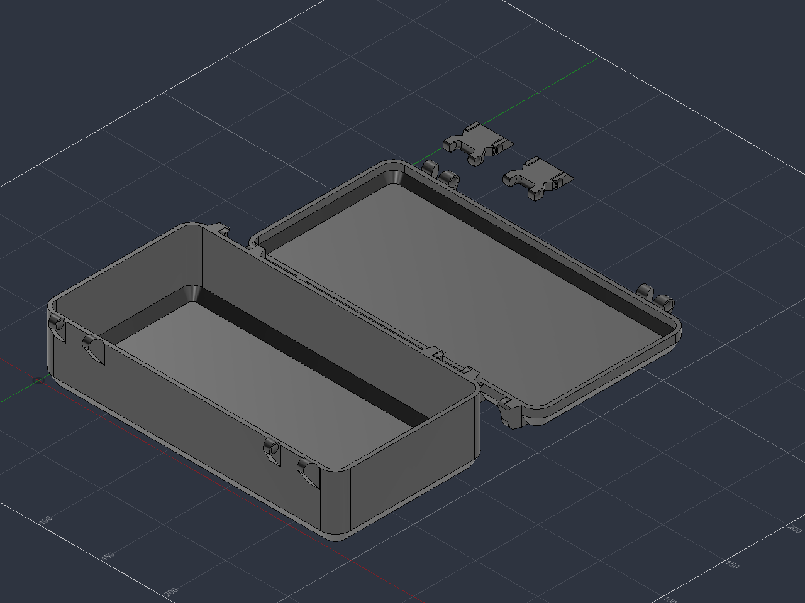

# Fusion Python 0.6.1 — đồng bộ và kiểm chứng native

Ngày 14/10/2026, script đã được chạy qua MCP local trong Fusion 2705.1.30. [Báo cáo native](../validation/fusion-parametric-native.json) và [log](../validation/fusion-parametric-native.log) ghi source/hash, 10 biến thể recompute, bốn solid, 40 plane, 57 sketch và 181 timeline item. Tất cả sketch fully constrained và feature healthy. Bộ unit test hiện tại gồm 59 test đạt.

Kiểm tra bằng temporary BRep đặt chi tiết đúng tư thế đóng cho baseline và bốn cấu hình minimum/nắp 20/nắp 233,1/cỡ 250 × 232,7 × 245,7 mm. Cả sáu cặp chi tiết ở mỗi cấu hình có giao thể tích bằng 0 mm³. Phép thử giữ nguyên timeline và khôi phục tham số mặc định sau kiểm tra.

## Hiệu chỉnh phát hiện khi chạy thật

Mặt côn của ngàm và cung web đo từ mẫu gần trùng nhau tại mép ngàm. BRep tolerant vẫn là solid, còn STL xuất ra có cạnh hở. Tăng hai bán kính tool côn thêm 0,001 mm tạo khoảng phân cách số học; độ dốc côn giữ nguyên. Thử native trước/sau xác nhận STL nắp trở thành một solid kín với 0 cạnh hở.

Exporter dùng preset High của Fusion. Custom tessellation trước đó tạo file nắp khoảng 806 MB; bản High hiện tại khoảng 0,55 MB. Cả bốn STL đã qua kiểm tra độc lập về solid kín, hash, bounds và đối chiếu SCAD/STL gốc. Sai khác thể tích đối xứng với SCAD: thân 0,07396%, nắp 0,01294%, latch khoảng 0,05639%.

Mesh High ở tư thế đóng có giao thân–nắp khoảng 0,40478 mm³, vượt ngưỡng mesh nghiêm ngặt 0,01 mm³. Các cặp latch dưới 0,01 mm³. BRep chính xác tại cùng tư thế có giao bằng 0; báo cáo ghi riêng hai loại bằng chứng. In FDM tiếp tục xác nhận độ khít và lực gài.

## Công thức cơ cấu

[Script chính](../../fusion/SnaplockStorageBox/SnaplockStorageBox.py) cập nhật `latch_span_delta = lid_height - 15 mm`. Blank, răng, channel và ramp cùng bám công thức; đầu cầu gắn nắp giữ vị trí cục bộ. Tai thân và tai nắp dùng chung `mount_end`. Giới hạn nắp thấp nhận mẫu 11,7 mm theo SCAD; giới hạn chiều dài và vị trí tai được căn theo miền source.

Hai cửa sổ khe đàn hồi dùng chung tám sketch tiết diện. Hai tool Loft dùng lại các sketch này; Move tương ứng 15 mm và `lid_height` đặt cửa sổ phía nắp và phía thân. Hai giá trị Move luôn dương trong miền hợp lệ. Clip phía đầu và giới hạn Y=7 mm ở nắp thấp giữ vật liệu đỡ cầu theo SCAD. Các tool được mirror rồi dùng chung một Cut, cuối cùng còn một latch liên thông theo hình học mục tiêu.

Fusion dựng cầu bằng Revolve chính xác và giữ bán kính ổ `pin_radius + fit_clearance`. SCAD dùng `cos^-2` để bù mặt cầu chia lưới; hệ số đó thuộc biểu diễn mesh. [Autodesk Parameters reference](https://help.autodesk.com/cloudhelp/ENU/Fusion-Model/files/GUID-76272551-3275-46C4-AE4D-10D58B408C20.htm) xác định cú pháp `if(condition; true_value; false_value)` và `min/max` dùng trong biểu thức clip.

## Kiểm chứng và Run

Regression kiểm tra tâm tai, vị trí bốn tiết diện răng theo chiều cao nắp ở cả hai hướng pháp tuyến, dịch profile và midpoint cung, tái sử dụng tám sketch, tiêu thụ bốn tool sau mirror và hiệu chỉnh côn. [Manifest offline 0.6.0](../validation/fusion-parametric-sync-offline.json) giữ checkpoint trước lần chạy native. [Assembly SCAD](latch-parametric-fix.md) giữ bằng chứng hình học của baseline tương ứng.

Trong Fusion, mở **Utilities → Scripts and Add-Ins → Scripts**, thêm thư mục `fusion/SnaplockStorageBox`, chọn `SnaplockStorageBox` và Run. Script tạo document mới và giữ thiết kế đang mở. Thiết kế đã dựng bằng script cũ giữ timeline cũ; Run 0.6.1 tạo timeline dùng công thức mới.

`VERIFY_VARIANTS=True` chạy kiểm tra recompute cho chiều cao nắp 11,7/20/50/233,1 mm, mẫu mini và cấu hình 250 × 232,7 × 245,7 mm, cùng các biến thể có sẵn. Mỗi lượt kiểm tra bốn solid, bounds, fully constrained sketches, vị trí tiết diện răng và timeline healthy. Sau thử, script khôi phục tham số ban đầu rồi xuất STL cùng manifest/hash.

Log runtime nằm ở `fusion/SnaplockStorageBox/last-run.log`; mesh và manifest nằm trong thư mục timestamp thuộc `fusion/SnaplockStorageBox/exports/`. Từ gốc repo, chạy `python tools/audit-fusion.py fusion/SnaplockStorageBox/exports/<timestamp>` để đối chiếu bộ xuất mặc định với SCAD và STL tham chiếu local. Lần native hiện tại xác nhận kernel, topology và solver cho các biến thể đã ghi; in FDM tiếp tục xác nhận lực gài và độ khít.

## Agent chạy qua MCP local

Fusion Preferences → API bật Fusion MCP Server; phiên thử này dùng `http://127.0.0.1:27182/mcp`. Các lời gọi initialize, notifications/initialized và tools/call giữ cùng kết nối HTTP persistent. Tool `fusion_mcp_execute` với `featureType=script` chạy hàm `run(_context)`; wrapper gọi trực tiếp build/check_model/verify_variants/export_meshes của source chính, truyền exception về MCP và ghi log từng stage. Script kiểm tra tạo document test mới, giữ các document đang mở và xuất archive F3D local sau xác minh.
