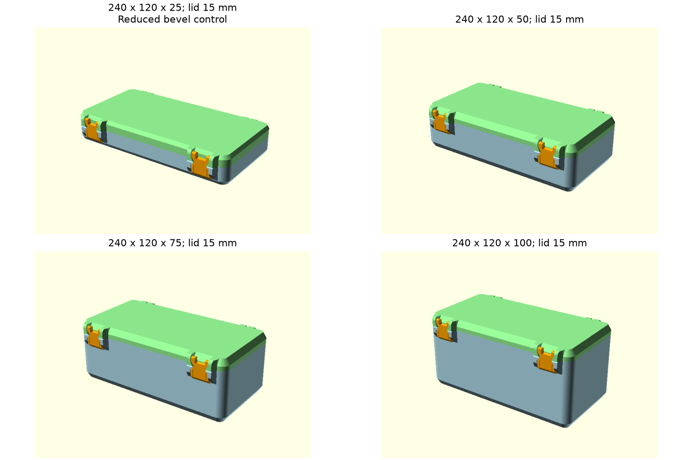

# Latch theo chiều cao nắp và kiểm chứng assembly — 14/10/2026

[Fusion 0.6.1](fusion-parametric-sync.md) đã chạy native với build/recompute, BRep lắp đóng và audit STL; hồ sơ Fusion liên kết ghi bằng chứng hiện tại.

[Fusion Python 0.6.0](fusion-parametric-sync.md) tiếp nối checkpoint này bằng cập nhật công thức trong source và 58 test offline. Nhận định Fusion 0.5.1 ở cuối hồ sơ mô tả trạng thái trước bước đồng bộ.

Source chính là [snaplock-storage-box.scad](../../snaplock-storage-box.scad), SHA256 `e1cbc7402b7a04ba5b5039f9260fea86289bbeafb99687790e8fd816ac3fdc55`. Bộ STL trong [samples](../../samples/README.md) và `outputs/default/` được xuất lại từ source này.

## Công thức và vị trí lắp

`latch_span_delta = lid_height - 15` điều chỉnh chiều dài plate, vị trí răng, đuôi khe đàn hồi và ramp phía thân. Đầu cầu cùng ổ gắn nắp giữ hình học cục bộ. Khe phía nắp giữ vùng thoát riêng; cutter được giới hạn để giữ vật liệu đỡ cầu ở nắp thấp. Nắp 11,7 mm dùng latch ngắn hơn baseline 3,3 mm; nắp 15 mm dùng span baseline.

Thân và nắp đặt tâm tai tại cùng hai tọa độ `mount_end` và `length - mount_end`. Ổ bản lề dùng bán kính cutter `(pin_radius + fit_clearance) / cos(180/$fn)^2`; chốt giữ `pin_radius`. Hệ số này bù bán kính nội tiếp của mặt cầu chia lưới. `fit_clearance` tiếp tục điều khiển khe hở chế tạo.

Phép lắp STL dùng rigid transform. Các datum phẳng được chuyển sang giá trị float32 của STL nhị phân trước phép dịch chuyển; thao tác này đồng nhất datum xuất file và datum lắp. Kích thước mesh giữ theo STL đã render.

Ở nắp rất cao, vùng khe phía nắp và vùng khe phía răng có thể tách nhau bằng cầu vật liệu. Solid tiếp tục được kiểm tra liên thông; độ cứng và lực gài được đánh giá bằng mẫu in cho từng miền chiều cao sử dụng.

## Kết quả hiện tại

| Bài kiểm tra | Kết quả |
|---|---|
| [Ma trận JSON](../validation/scad-parametric-assembly.json), [CSV](../validation/scad-parametric-assembly.csv) | 112 đầu vào; 107 bộ lắp đóng đạt, 5 đầu vào bị assert giới hạn |
| Miền kích thước | 60 bộ kích thước thân khác nhau; góc biên nhỏ nhất đến 250 mm; chiều cao nắp 11,7–245,5 mm |
| Giao thể tích | Mỗi cặp thân–nắp, latch–thân, latch–nắp và latch–latch dưới 0,01 mm³; cực đại quan sát khoảng 3,53 × 10⁻¹² mm³ |
| Chuyển động lấy mẫu | 6 cấu hình × 8 góc mở = 48 tư thế, latch đã tháo; giao thân–nắp dưới 0,01 mm³ |
| Khổ 250³ | 104 bộ vừa kích thước bao số học, 3 bộ vượt; phần chừa brim/support bằng 0 mm |
| Unit test | 54 test; regression nắp 11,7/15/20/233,1 mm và bản lề `$fn=32/96/192` |

Khổ in được đo riêng từng part. Vỏ danh nghĩa 250³ có tai/chốt vượt khổ; hai latch ứng với nắp 245,5 mm cũng vượt chiều dài 250 mm. Trạng thái lắp hình học và trạng thái vừa bàn in được ghi riêng trong báo cáo.

[Đối chiếu STL gốc hiện tại](../validation/scad-current-default.json) ghi sai khác thể tích đối xứng: thân 0,09299%, nắp 0,24810%, latch 0,04924%. Mục tiêu lịch sử của nắp giữ 0,2%; báo cáo ghi `geometry_checks_passed=true`, `reference_targets_met=false`. Hiệu chỉnh tâm tai và ổ bản lề được đánh giá thêm bằng assembly chức năng.

Các báo cáo 65 cấu hình và minimum ngày 13/10 mô tả baseline trước sửa. Hash source trong mỗi báo cáo xác định đúng checkpoint. [Quy trình đổi tham số](../guides/parameter-change-validation.md) áp dụng kiểm tra từng part, bộ lắp, chuyển động, envelope và mẫu in.

## Phạm vi xác nhận

Kết quả trên xác nhận solid và các tư thế hình học đã lấy mẫu. Bước kiểm chứng vật lý tiếp theo là in FDM để đo khe lắp, độ khít mép, lực gài, retention và độ bền sau nhiều chu kỳ. Fusion Python 0.5.1 giữ baseline cơ cấu trước cập nhật này; chuyển công thức và kiểm tra solver/kernel native là bước triển khai tiếp theo.
