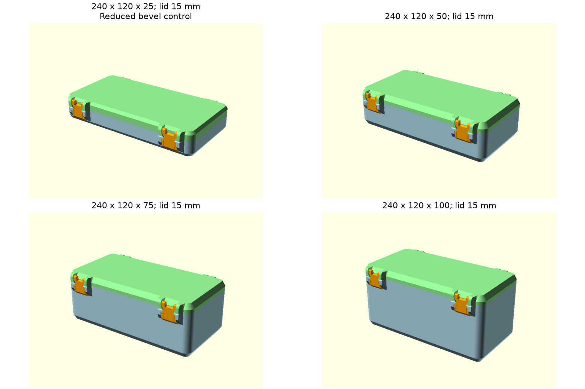
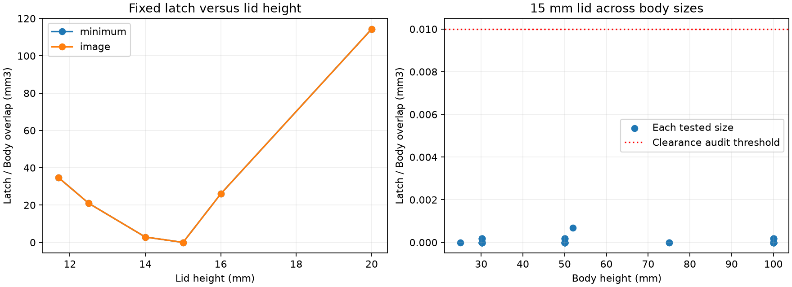

# Kiểm tra lắp kín theo 65 cấu hình kích thước

**Checkpoint lịch sử:** số đo và nhận định dưới đây thuộc source/hash tại thời điểm báo cáo. [Hồ sơ SCAD ngày 14/10/2026](latch-parametric-fix.md) ghi cơ cấu và kết quả hiện tại.

Ngày 14/10/2026, audit dùng SCAD hiện tại để render Body/Lid của từng cấu hình, lắp nắp và hai latch vào tư thế đóng theo công thức tâm cơ cấu, rồi đo giao thể tích bằng Manifold Mesh64. Mỗi mesh render thành công được xác nhận là một solid kín, thể tích dương. Latch giữ kích thước tham chiếu, nắp mặc định cao 15 mm.

Các kích thước trong ảnh người dùng được diễn giải thành đầu vào SCAD 240 × 120 mm, thân cao 25/50/75/100 mm. Phép thử dùng các giá trị đầu vào này để dựng mới model của repo; ảnh cung cấp tên kích thước cho ma trận.

## Ma trận và kết quả

| Nhóm | Phạm vi | Số cấu hình |
|---|---|---:|
| Lưới kích thước | Dài 107,9/150/200/240 × rộng 30,1/60/120/220 × cao thân 30,2/50/100 mm, nắp 15 mm | 48 |
| Bổ sung mẫu trong ảnh | 240 × 120 × 75 mm, nắp 15 mm | 1 |
| Kích thước tham chiếu | 237,85 × 123,15 × 52 mm, nắp 15 mm | 1 |
| Chiều cao nắp | Nắp 11,7/12,5/14/16/20 mm trên bộ minimum và bộ 240 × 120 × 50 mm | 10 |
| Thân cao 25 mm | 240 × 120 × 25 với thông số mặc định và đối chứng giảm vát đáy | 2 |
| Bật cả ba nhóm gân | 150 × 60 × 50; 240 × 120 × 75; 240 × 220 × 100 mm, nắp 15 mm | 3 |
| Tổng | | **65** |

Kết quả ghi **54 cấu hình `latch_clear`**, **10 cấu hình `latch_interference`** và **1 cấu hình `rejected_source_bounds`**. Các cấu hình render thành công bao phủ 51 bộ dài–rộng–cao thân khác nhau. Ngưỡng phân loại latch là thể tích giao <0,01 mm³ cho từng cặp latch–Body, latch–Lid và latch–latch. `latch_clear` biểu diễn kết quả kiểm tra latch tại tư thế đóng; Body–Lid và tiếp xúc bản lề được đo riêng.

| Kích thước trong ảnh | Kết quả trên model repo, nắp 15 mm |
|---|---|
| 240 × 120 × 25 mm, mặc định | SCAD báo giới hạn `body_height`; ngưỡng hiện tại >30,14064 mm |
| 240 × 120 × 25 mm, giảm vát | `latch_clear`; dùng `bottom_bevel=3`, `body_inner_bevel=1.5`, `floor_rib_height=2` mm |
| 240 × 120 × 50 mm | `latch_clear` |
| 240 × 120 × 75 mm | `latch_clear` |
| 240 × 120 × 100 mm | `latch_clear` |

Cấu hình 25 mm giảm vát là một đối chứng với ba tham số thay đổi được ghi rõ, dùng source hiện tại. Thông số mặc định và source model giữ nguyên.



## Chiều cao nắp quyết định vị trí răng latch

Đổi chiều dài, chiều rộng và chiều cao thân trong lưới với nắp 15 mm đều đạt tiêu chí latch. Cực đại thể tích giao latch–Body trong 54 cấu hình này là khoảng **0,000691 mm³**, thấp hơn ngưỡng 0,01 mm³.

Đổi chiều cao nắp làm ổ cầu và latch dịch theo Z, còn hốc thân cùng tọa độ dọc răng giữ công thức cũ. Cả hai footprint được thử đều cho kết quả cấn ở năm chiều cao nắp sau:

| Chiều cao nắp | Giao latch–Body lớn nhất mỗi khóa, xấp xỉ |
|---:|---:|
| 11,7 mm | 34,684 mm³ |
| 12,5 mm | 20,934 mm³ |
| 14 mm | 2,871 mm³ |
| 15 mm | ≤0,000691 mm³ trong ma trận |
| 16 mm | 26,040 mm³ |
| 20 mm | 114,333 mm³ |

Kết quả xác nhận [lỗi preset minimum](latch-minimum-fit.md) là một biểu hiện của khoảng cách pivot–catch giữ cố định khi chiều cao nắp thay đổi. Cấu hình nắp 15 mm là cấu hình cơ cấu tham chiếu được kiểm tra ở ma trận này. Miền chiều cao nắp rộng hơn cần công thức cơ cấu đi theo tham số và bài thử assembly tương ứng.



## Phạm vi xác nhận

Trong 54 cấu hình `latch_clear`, Body–Lid vẫn có khoảng **6,274–6,276 mm³** giao nhau: khoảng **5,884 mm³** ở vùng sau `Y<0`, phần còn lại khoảng **0,390–0,392 mm³** ở giao diện vỏ khác. Mức tiếp xúc này tương tự cấu hình tham chiếu và hiện diện ở mọi kích thước đạt tiêu chí latch. Vì vậy kết quả lắp cứng được tách thành tiêu chí latch và số đo giao diện thân–nắp; kiểm chứng lắp khít toàn bộ tiếp tục qua đánh giá cơ cấu và thử in.

Ma trận xác nhận hình học tại tư thế đóng. Đường đưa latch vào ổ, chuyển động liên tục của nắp, biến dạng đàn hồi, lực cài, khe FDM và độ kín là các bước kiểm chứng riêng. Cặp bi–ổ cầu giữ sai lệch pitch 0,25 mm mỗi bên theo X của cơ cấu tham chiếu như ghi trong [audit minimum](latch-minimum-fit.md).

## Tái lập và hồ sơ

[JSON đầy đủ](../validation/latch-size-matrix.json) lưu source/hash, helper/hash, tham số, hash STL, số mặt zero-width đã làm sạch theo hợp đồng audit hiện có, phân loại và từng phép giao. [CSV](../validation/latch-size-matrix.csv) cung cấp bảng số đo để lọc theo kích thước.

```powershell
python tools/audit-latch-matrix.py
```

Môi trường dùng các thư viện đã có `numpy`, `trimesh`, `manifold3d`, `matplotlib` và OpenSCAD qua biến `OPENSCAD`. Đầu ra `outputs/latch-fit-matrix` giữ Body/Lid cùng log cho mỗi cấu hình, latch chung, báo cáo và ảnh. File `assembly.scad` cho chọn `case_index` để xem 64 cấu hình render thành công; `show_latch_collision` hiện giao latch–thân và `show_shell_contact` hiện giao thân–nắp. Cấu hình mặc định của viewer là 240 × 120 × 50 mm, nắp 15 mm.
