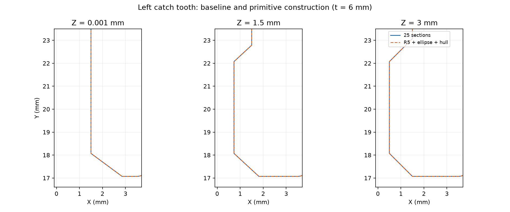

# Răng khóa SCAD dùng trụ R5, elip và bao lồi.

Checkpoint ngày 13/10/2026 chuyển răng khóa từ 25 tiết diện theo Z sang `latch_tooth()`, dùng trụ R5, bốn tiết diện tròn/elip mỏng, hai `hull()` ngắn và một phép giao giới hạn. Khe đàn hồi tiếp tục dùng `slot_profile(z)` cùng 25 tiết diện. Snapshot trước thay đổi có commit `1b88b6b`; báo cáo lưu SHA256 của snapshot và source mới.

Hồ sơ này giữ checkpoint răng tại commit `7711ae6`. [Checkpoint khe hybrid tiếp theo](scad-slot-hybrid.md) dùng tám tiết diện phần trước cùng đuôi Extrude và có source hash, số đo, ngưỡng cùng lệnh tái tạo riêng.

## Công thức xác định hình học.

Với `t = latch_thickness`, `u = z-t/2` và `d = 5-sqrt(25-u²)`, biên đầu răng `x = 0.5+d` thỏa `(x-5.5)²+u²=25`. Tiết diện XZ có tâm `(5.5,t/2)` và bán kính 5 mm. Biên vai `x = 1.5+1.35*d` thỏa `(x-8.25)²/6.75²+u²/5²=1`, với tâm `(8.25,t/2)` và bán trục 6,75/5 mm.

Trụ giữa chạy theo Y từ 18,0724 đến 22,0724 mm. Tiết diện vai nằm tại Y=17,0724 và 23,0724 mm. Hai đoạn chuyển tiếp dài 1 mm nối vai elip với đầu tròn. Khối giao giữ X từ −2 đến 3,5 mm, Y từ 17,0724 đến 23,0724 mm và Z từ 0 đến `t`. Cặp răng dùng chung module qua phép đối xứng X=14 mm.

`eps` tạo độ dày hữu hạn cho tiết diện và độ chồng ở mối nối boolean. Tâm Z theo `t/2` và envelope theo `t`, nên công thức đi theo chiều dày khóa. `$fn=96` xác định mức chia đa giác của tròn/elip trong bộ kiểm chứng này.

## Phép dựng và sai lệch có phạm vi rõ ràng.

Theo [tài liệu OpenSCAD](https://files.openscad.org/documentation/manual/The_OpenSCAD_Language.html), `hull()` tạo bao lồi của các khối con. Bản cũ nối các điểm tương ứng trên 25 tiết diện bằng mặt phẳng. Bản mới dùng bao lồi ở hai vùng chuyển tiếp; đây là một phép xấp xỉ đã được đo riêng. Trụ giữa và tiết diện vai biểu diễn trực tiếp quy luật tròn/elip, với bề mặt mesh chịu mức chia `$fn`.

Agent phân biệt đường cong trên tiết diện với quy luật nối tiết diện trong không gian. Cùng tâm và bán kính cung cấp căn cứ cho tiết diện; mặt cắt trung gian, boolean và khoảng cách bề mặt cung cấp căn cứ cho vùng chuyển tiếp. Bản Fusion dùng hai Loft native ở vùng này và có checkpoint runtime riêng.

## Kết quả so sánh xác nhận cấu hình được giữ.

[Báo cáo JSON](../validation/scad-catch-csg.json) lưu phép đo hai chiều tại mọi đỉnh và tâm mặt trong vùng răng, cộng điểm lấy mẫu bề mặt có seed cố định. Cực đại dưới đây là cực đại quan sát trên tập đo. Phép đo này cung cấp bằng chứng lấy mẫu cục bộ; Hausdorff toàn bề mặt là một phép kiểm chứng riêng.

| Chiều dày mm | Sai khác thể tích với bản cũ | Cực đại khoảng cách quan sát mm | Sai khác bounds với bản cũ mm |
|---|---:|---:|---:|
| 5 | 0,002154% | 0,006786 | 0 |
| 6 | 0,001692% | 0,006761 | 0 |
| 6,5 | 0,001544% | 0,005810 | 0 |

Ở chiều dày 6 mm, sai khác thể tích đối xứng với STL gốc đạt 0,042337%, so với mốc cũ 0,042916%. Sai khác bounds với STL là 0,002008 mm. Audit mặc định và biến thể vỏ 280×155 mm, cao thân 70 mm đều tạo layout bốn solid kín. Thân và nắp giữ nguyên số đo của baseline.

Pipeline xuất binary STL ghi nhận bốn mặt rời co về độ rộng bằng 0 ở khóa mới dày 6 mm. Bộ xử lý có sẵn kiểm tra diện tích <10⁻⁵ mm², |thể tích| <10⁻⁸ mm³ và giữ solid kín trước khi lưu. OpenSCAD Manifold báo `NoError`; Trimesh phát cảnh báo chia cho thể tích 0 khi phân tích mảnh suy biến. Báo cáo audit ghi số mặt đã xử lý.



Ba lượt dựng mỗi nguồn cho trung vị khoảng 0,315/0,328 giây tại t=5, 0,325/0,358 giây tại t=6 và 0,328/0,329 giây tại t=6,5, theo thứ tự cũ/mới. Đồng hồ gồm khởi chạy process, render, đọc mesh và xử lý mặt suy biến. Các lượt chạy tuần tự cung cấp số đo tham khảo trên máy hiện tại. Lợi ích đã xác nhận là ý đồ hình học rõ ràng và sai lệch nhỏ; lợi ích tốc độ cần phép benchmark chuyên biệt.

## Rà các vùng tương tự xác định cách dựng phù hợp.

| Vùng trong source | Kết quả rà và phương pháp hiện tại |
|---|---|
| Hai răng khóa | Một module tròn/elip, hai vùng bao lồi ngắn và phép đối xứng tạo cặp răng. |
| Khe đàn hồi | `slot_profile(z)` giữ nhiều cung R0,5, cung có tâm thay đổi và các hệ số blend địa phương; 25 tiết diện giữ baseline của vùng này. |
| Rãnh R5 bo đầu R2 | `notch_tool()` đã dùng một profile tròn xoay qua `rotate_extrude()`. |
| Vỏ, lòng và vát đáy | `offset()`, Extrude và hai tiết diện `hull()` đã mô tả bo góc cùng độ vát. |
| Hốc ngàm, ổ cầu và chốt cầu | Trụ, nón chamfer, cầu và các phép giao đã diễn tả đặc trưng cơ bản. |
| Cung trên tai/gân | `arc(a,m,b)` suy tâm và bán kính từ ba điểm rồi sinh polygon 2D cho Extrude; Fusion có thể dùng cung native từ cùng quy luật. |

Phạm vi rà là toàn bộ source SCAD của Snaplock. Mỗi vùng có phép dựng đi theo hình học và contract riêng. Tối ưu khe đàn hồi là một thay đổi riêng, với đo mặt cắt, mô hình chuyển tiếp và bộ so sánh tương ứng.

## Phương pháp tự học ưu tiên quy luật đã được kiểm chứng.

1. Agent lưu snapshot, SHA256, bộ tham số và ngưỡng chấp nhận trước khi thay cách dựng.
2. Agent nhóm điểm theo cùng đường biên và cùng hệ tọa độ, rồi khảo sát đoạn thẳng, tròn, elip, trụ, cầu, nón và đối xứng.
3. Agent suy tâm, bán kính và quan hệ tham số từ công thức có sẵn hoặc phép fit có RMS cùng cực đại sai số.
4. Agent kiểm tra riêng tiết diện và mặt nối giữa tiết diện; phép dựng `hull`, Loft và ruled surface có tiêu chí đối chiếu riêng.
5. Agent dùng primitive, Extrude, Revolve và phép boolean cho vùng phù hợp; profile lấy mẫu phục vụ vùng chuyển tiếp có quy luật phức tạp.
6. Agent so sánh bản mới với snapshot và STL gốc, gồm solid kín, bounds, thể tích thừa/thiếu, mặt cắt và khoảng cách hai chiều.
7. Agent thử các biên tham số có ý nghĩa, ghi mức chia mesh, công cụ, hash và phạm vi đo thời gian.
8. Agent chuyển cùng tâm, bán kính và expression sang feature native Fusion, rồi xác nhận recompute và STL xuất từ Fusion tại checkpoint riêng.

## Lệnh chạy tái tạo bộ so sánh.

Chạy tại checkout `7711ae6` với dependency trong `requirements.txt`, OpenSCAD Manifold trong PATH hoặc biến môi trường `OPENSCAD`. Snapshot SCAD trước thay đổi được trích từ commit đã ghi:

```powershell
git archive --format=zip --output=outputs/catch-baseline.zip 1b88b6b snaplock-storage-box.scad
Expand-Archive -LiteralPath outputs/catch-baseline.zip -DestinationPath outputs/catch-baseline -Force
python tools/audit-catch-csg.py --baseline outputs/catch-baseline/snaplock-storage-box.scad
python tools/audit-scad.py
python tools/audit-scad.py --variant
python tools/compare-scad.py
```

Audit khóa đặt `$fn=96`, kiểm tra t=5/6/6,5, lưu mesh, log render, hash, timing và `audit.json` vào thư mục output. Ngưỡng so với snapshot là bounds <0,01 mm, sai khác thể tích <0,01% và cực đại khoảng cách quan sát <0,01 mm. Ngưỡng với STL gốc ở t=6 là bounds <0,02 mm và sai khác thể tích <0,1%.
