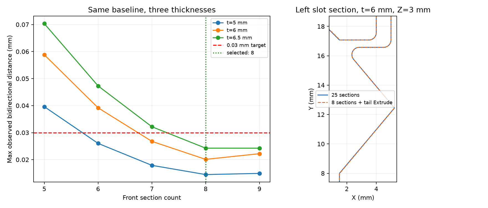

# Khe đàn hồi kết hợp Extrude và Loft tám tiết diện.

Checkpoint ngày 13/10/2026 tách khe thành đuôi cố định và phần trước thay đổi theo chiều dày. Snapshot tại commit `7711ae6` chứa khe 25 tiết diện cùng răng tròn/elip đã kiểm chứng. Source SCAD hiện tại dùng Extrude cho đuôi và tám tiết diện cho phần trước. Fusion Python 0.4.0 biểu diễn cùng cấu trúc bằng feature native, với checkpoint runtime riêng.

## Hai vùng có phép dựng phù hợp với hình dạng.

Đuôi khe có biên XY cố định: hai cạnh thẳng, đầu tròn R0,5 và cung chuyển tiếp R0,5. SCAD dùng `linear_extrude()` xuyên chiều dày; Fusion dùng một sketch cùng một Extrude. Đuôi mở rộng 0,001 mm về phía trước tại Y=17,0724 mm để tạo vùng chồng boolean với phần trước.

Phần trước giữ miệng khe, cung bo dịch chuyển, cung R0,5 ở góc và biên sát răng. Hàm `slot_front_profile(z)` trong SCAD và `slot_front_section(fraction)` trong Fusion mô tả cùng đường bao. Mỗi tiết diện Fusion có hai cung; đuôi có hai cung được dựng một lần.

Khối đuôi và khối trước được hợp thành một dụng cụ cắt, đối xứng qua X=14 mm rồi cắt hai khe. Luồng này giữ ownership rõ ràng: Extrude tạo tool đuôi, Loft tạo tool trước, Join tiêu thụ tool đuôi, Mirror tạo tool đối xứng và Cut tiêu thụ hai tool cuối.

## Tám tiết diện đi theo góc cung R5 và chiều dày.

Với `t = latch_thickness`, `f = i/7`, `i = 0…7`, các biểu thức là:

```text
theta = asin(t/10) * (2*f - 1)
z = t/2 + 5*sin(theta)
d = 5 - 5*cos(theta)
```

Trên miền t=5…6,5 mm, công thức này tương đương `d = 5-sqrt(25-(z-t/2)^2)`. SCAD tính hàm lượng giác bằng độ; các hàm lượng giác trong biểu thức Fusion nhận góc do `asin` trả về. Tỷ số `latch_thickness / (10 mm)` có kiểu không đơn vị, theo [bảng biểu thức Autodesk](https://help.autodesk.com/cloudhelp/ENU/Fusion-Model/files/GUID-76272551-3275-46C4-AE4D-10D58B408C20.htm).

Tiết diện đầu Fusion dùng Origin XY tại `0 mm`; tiết diện cuối dùng expression `latch_thickness`. Sáu tiết diện giữa dùng công thức góc có liên kết tham số. SCAD thêm hai vòng điểm ngoài chiều dày tại −eps và t+eps để dụng cụ cắt xuyên mặt đầu/cuối.

## Ngưỡng đối chiếu và phép chọn số tiết diện có bằng chứng.

Theo yêu cầu tối giản cho mục đích in 3D, bộ đối chiếu dùng cực đại khoảng cách bề mặt lấy mẫu cục bộ dưới 0,03 mm và sai khác thể tích với snapshot dưới 0,03%. Bounds với snapshot giữ giới hạn 0,01 mm. So với STL gốc tại t=6, các giới hạn là bounds dưới 0,02 mm và sai khác thể tích dưới 0,1%.

[Hồ sơ thử số tiết diện](../validation/scad-slot-section-probes.json) lưu các trường hợp ở t=5/6/6,5 mm. Tám là số tiết diện thấp nhất đạt trong nhóm 5–9 đã khảo sát.

| Số tiết diện phần trước | Cực đại khoảng cách quan sát qua ba chiều dày mm | Kết quả theo ngưỡng 0,03 mm |
|---|---:|---|
| 5 | 0,070338 | Vượt ngưỡng |
| 6 | 0,047299 | Vượt ngưỡng |
| 7 | 0,032183 | Vượt ngưỡng |
| 8 | 0,024256 | Đạt |
| 9 | 0,024248 | Đạt |

[Audit được chọn](../validation/scad-slot-hybrid.json) kiểm tra hai chiều tại mọi đỉnh, tâm mặt và điểm lấy mẫu có seed cố định trong vùng khe. Cực đại lấy mẫu mô tả tập điểm đã kiểm tra; đánh giá Hausdorff liên tục toàn bề mặt thuộc bước kiểm chứng tiếp theo.

| Chiều dày mm | Sai khác thể tích với snapshot | Cực đại khoảng cách quan sát mm | Sai khác bounds mm |
|---|---:|---:|---:|
| 5 | 0,012273% | 0,014482 | 0 |
| 6 | 0,018505% | 0,020107 | 0 |
| 6,5 | 0,022434% | 0,024256 | 0 |

Khóa dày 6 mm có sai khác thể tích với STL gốc 0,049243%, so với 0,042337% ở snapshot 25 tiết diện. Đây là mức đánh đổi đã đo giữa độ bám mesh và độ gọn của cách dựng. Sai khác bounds với STL là 0,002008 mm. Audit mặc định và biến thể vỏ 280×155 mm, cao thân 70 mm đều xác nhận layout bốn solid kín; số đo thân và nắp giữ nguyên.

Khóa mặc định xuất 10.150 tam giác, so với 18.878 tam giác ở snapshot. Bộ xử lý xuất có sẵn loại tám mặt rời suy biến theo giới hạn diện tích <10⁻⁵ mm² và |thể tích| <10⁻⁸ mm³, rồi xác nhận solid kín. OpenSCAD Manifold báo `NoError`; cảnh báo Trimesh về thể tích 0 đi cùng phép phân tích mảnh suy biến. Timing trong JSON là một lượt gồm process, render và đọc/xử lý mesh, phục vụ tham khảo; benchmark tốc độ là phép đo riêng.

## Source Fusion giảm số đối tượng và giữ công thức.

| Phần khe | Baseline | Bản hybrid |
|---|---:|---:|
| Plane tạo thêm | 25 | 7 |
| Sketch | 25 | 9 |
| Modeling feature | 3 | 5 |
| Tổng mục theo luồng source | 53 | 21 |
| Cung trong các sketch khe | 100 | 18 |

Bản hybrid giảm 32 mục theo source và 82 cung sketch. Chuỗi dài nhất của vùng trước gồm sketch trên Origin XY cùng bảy cặp Plane → Sketch, sau đó Loft tạo khối. Đuôi có một sketch và Extrude riêng. Log `SLOT_BUILD` ghi số tiết diện, số Extrude đuôi, phương pháp lấy mẫu và ngưỡng SCAD.

36 test offline xác nhận công thức tại ba chiều dày, đối xứng, vị trí tám tiết diện, profile đuôi, đầu vào Mirror và luồng tiêu thụ tool khi Join/Cut. Lần Run native xác nhận solver, Loft, Join, Mirror, recompute và số timeline thực tế. Audit STL xuất từ Fusion đối chiếu sai lệch native với SCAD và mẫu gốc. Thử in xác nhận khe hở, lực đàn hồi và độ bền của cơ cấu thực.

## Phương pháp tự học tách vùng trước khi giảm số tiết diện.

1. Agent lưu snapshot, hash, tham số và ngưỡng phù hợp với mục đích của chi tiết.
2. Agent tìm vùng có biên cố định theo chiều cao và dùng Extrude cho vùng đó.
3. Agent phân tích riêng vùng biến đổi, cung dịch chuyển và mặt nối giữa các tiết diện.
4. Agent giữ công thức thiết kế, thử cách lấy mẫu theo chiều cao hoặc góc cung, rồi đo các mặt trung gian.
5. Agent thử nhiều mức tiết diện, chọn mức thấp nhất đạt toàn bộ biến thể đã chốt và lưu cả trường hợp vượt ngưỡng.
6. Agent đánh giá solid kín, bounds, thể tích thừa/thiếu, mặt cắt và khoảng cách hai chiều cùng nhau.
7. Agent ghi rõ số đo lấy mẫu, số đối tượng suy từ source, timing tham khảo và kết quả runtime thành các bằng chứng riêng.
8. Agent chuyển cùng quy luật sang Fusion User Parameters và xác nhận cập nhật expression bằng recompute cùng STL xuất.

Phương án thử tách thêm biên sát răng bằng khối giải tích và lấy mẫu thưa đã vượt ngưỡng 0,01 mm ban đầu ở một số điểm. Phương án 17 tiết diện theo các cao độ gốc đạt ngưỡng đó. Yêu cầu tăng dung sai dẫn tới bộ thử 5–9 tiết diện và lựa chọn tám tiết diện theo góc cung. Việc nhận diện được tròn/elip cung cấp quy luật của biên; hình dạng vùng nối và sai lệch mesh quyết định phép dựng cuối.

## Lệnh tái tạo bộ đối chiếu.

Chạy tại repo với dependency trong `requirements.txt`, gồm `rtree` phục vụ tìm tam giác gần nhất, và OpenSCAD Manifold trong PATH hoặc biến môi trường `OPENSCAD`. `baseline_sha256` xác định byte của snapshot local dùng CRLF; `baseline_lf_sha256` xác định cùng nội dung sau chuẩn hóa xuống dòng LF và khớp file từ `git archive` tại commit `7711ae6`. Mỗi lần chạy lưu cả hai hash để đối chiếu nguồn trên các môi trường:

```powershell
git archive --format=zip --output=outputs/slot-baseline.zip 7711ae6 snaplock-storage-box.scad
Expand-Archive -LiteralPath outputs/slot-baseline.zip -DestinationPath outputs/slot-baseline -Force
python tools/audit-slot-hybrid.py --baseline outputs/slot-baseline/snaplock-storage-box.scad
python tools/audit-scad.py
python tools/audit-scad.py --variant
python tools/compare-scad.py
python -m unittest discover -s tests
```


