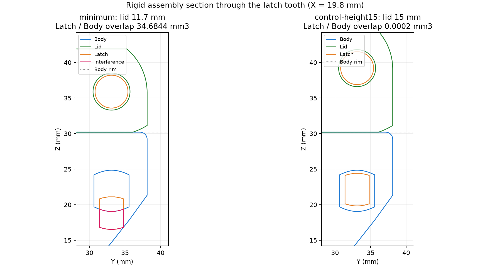

# Kiểm tra lắp latch của mẫu minimum

Người dùng báo bộ minimum in thật gắn được latch vào nắp; khi cài latch vào thân, mép nắp và mép thân bị hở. Phép kiểm tra sau dùng đúng ba STL trong `print-tests/minimum` và dựng một nắp cao 15 mm làm đối chứng.

## Nguyên nhân hình học

Latch minimum giống từng byte với latch mặc định và bản reinforced enhanced, có kích thước bao khoảng 27,996 × 31,835 × 6 mm. Latch STL gốc có kích thước 28 × 31,835 × 6 mm. Preset minimum giảm nắp từ 15 xuống 11,7 mm, còn ổ cầu nắp đặt tại Z local = 6 mm và răng latch giữ vị trí dọc cũ. Đây là lỗi chọn miền tham số của preset minimum.

Phép đặt căn tâm của cả cặp bi với tâm của cả cặp ổ cầu theo X. Khoảng cách hai tâm bi là 20,5 mm, còn hai tâm ổ là 21 mm; từng tâm bi nằm vào trong 0,25 mm so với tâm ổ tương ứng. Độ lệch này có sẵn ở cơ cấu tham chiếu và được ghi riêng với yêu cầu xác nhận lắp vật lý.

Trong tư thế đóng, phép đặt nắp là `X=x, Y=width-y, Z=body_height+lid_height-z`. Tâm bản lề nắp local tại Z=`lid_height` vì vậy trùng cao độ bản lề thân ở `body_height`. Tâm ổ cầu latch local tại Z=6 lại nằm tại `body_height+lid_height-6`. Khi giảm nắp 3,3 mm, ổ cầu và toàn bộ latch đi xuống 3,3 mm so với hốc giữ của thân.

| Đại lượng theo hệ tọa độ thân | Nắp minimum 11,7 mm | Nắp đối chứng 15 mm |
|---|---:|---:|
| Cao độ tâm ổ cầu latch | 35,9 mm | 39,2 mm |
| Khoảng Z lõi trụ răng latch | 16,8276–20,8276 mm | 20,1276–24,1276 mm |
| Khoảng Z hốc thân có chamfer | 18,7–25,2 mm | 18,7–25,2 mm |
| Thể tích latch thứ nhất giao thân | 34,684409 mm³ | 0,000173 mm³ |
| Thể tích latch thứ hai giao thân | 34,684467 mm³ | 0,000173 mm³ |

Phép thử giữ nguyên Body và Latch, thay đúng một biến là chiều cao nắp. Răng của latch minimum nằm dưới vùng hốc thân; khi cài khóa, sự cấn này tạo xu hướng nâng nắp để tìm vị trí ăn khớp. Độ lệch hình học là 3,3 mm; khe hở thực tế còn phụ thuộc góc xoay latch, độ đàn hồi và sai số in.



Màu xanh dương biểu diễn thân, xanh lá biểu diễn nắp, cam biểu diễn latch và hồng biểu diễn phần giao nhau. Ảnh lấy mặt cắt X=19,8 mm qua răng bên trái. Ảnh trái thể hiện răng thấp hơn hốc; ảnh phải thể hiện răng nằm trong hốc khi dùng nắp 15 mm.

## Bản đối chứng và phạm vi kiểm chứng

[Bộ nắp minimum 15 mm](../print-tests/minimum-lid15/README.md) cung cấp STL và preset riêng để in một nắp, sử dụng tiếp thân cùng hai latch đã in. SCAD chính và ba STL minimum cũ giữ nguyên làm bằng chứng. Mẫu nắp đối chứng đã render từ source hiện tại, là một solid kín, và được lắp theo đúng các công thức ở trên.

[Báo cáo số đo](validation/latch-minimum-fit.json) lưu hash source, hash ba STL đã kiểm tra, kích thước và thể tích giao. Latch–Lid có giao nhau ở mức nhiễu số học khoảng 10⁻¹⁴ mm³. Body–Lid có giao nhau khoảng 6,275 mm³ ở cả hai cấu hình, chủ yếu ở vùng bản lề của hình học tham chiếu; phần này được giữ làm hạng mục xác nhận lắp vật lý riêng. Phép đối chứng xác nhận nguyên nhân cấn latch của preset nắp thấp; in thử xác nhận cơ cấu hoàn chỉnh.

Lệnh tái lập tại thư mục repo:

```powershell
python audit-latch-fit.py
```

Audit dùng Python có `numpy`, `trimesh`, `manifold3d`, `matplotlib`, OpenSCAD qua biến `OPENSCAD` và STL tham chiếu tại đường dẫn của `audit-scad.py`. Đầu ra `exports/latch-fit-minimum` gồm report, ảnh mặt cắt, nắp đối chứng và `assembly.scad`. Mở `assembly.scad` trong OpenSCAD, chọn `control_height15` để so hai nắp và `show_interference` để hiện phần cấn. Hai STL `*-assembly.stl` là cụm lắp dùng quan sát hình học.

## Bài học áp dụng

Agent kiểm tra miền tham số của cơ cấu bằng vị trí lắp thực tế. Kích thước bao, solid kín và độ giống STL được dùng cùng kiểm tra khoảng cách pivot–catch, vị trí răng trong hốc và thể tích giao ở tư thế đóng. Thay đổi chiều cao nắp được truyền nhất quán đến ổ cầu hoặc chiều dài cơ cấu, rồi được đối chiếu bằng assembly trước khi chọn preset in thử.

Fusion 0.5.1 cũng dùng ổ cầu nắp tại `6 mm` và răng latch có tọa độ dọc cố định. Biến thể nắp `12.5 mm` trong script là bài kiểm tra recompute; mức xác nhận lắp cơ cấu của biến thể đó cần cùng audit assembly. Cấu hình nắp 15 mm giữ khoảng cách cơ cấu của mẫu tham chiếu cho bài thử hiện tại.
