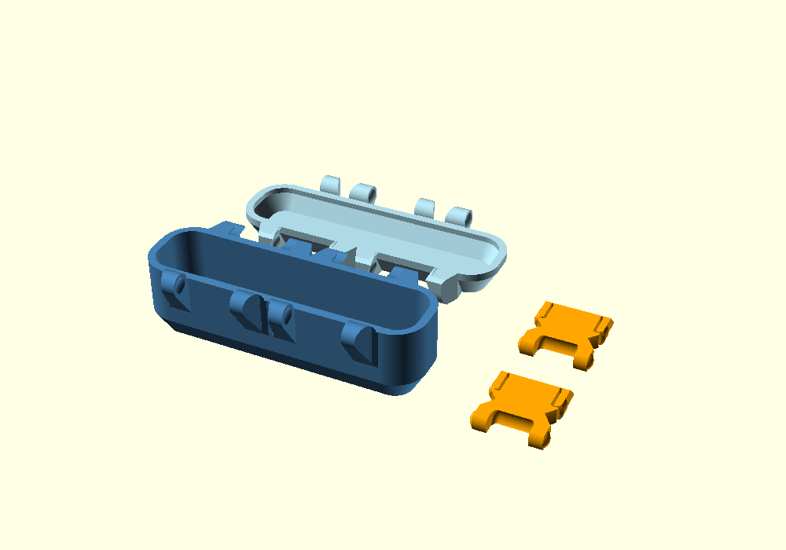

# Bản in test kích thước nhỏ

**Kết quả lắp 13/10/2026:** preset nắp 11,7 mm làm ổ cầu và răng latch thấp hơn vị trí tham chiếu 3,3 mm. [Kiểm tra assembly](../../docs/latch-minimum-fit.md) tái hiện khoảng 34,684 mm³ giao nhau giữa mỗi latch với thân. [Nắp đối chứng 15 mm](../minimum-lid15/README.md) cung cấp STL riêng để thử tiếp với thân và latch đã in. Các file bên dưới giữ nguyên trạng thái mẫu cũ để đối chiếu.

Bản test dùng source SCAD chính và [preset riêng](parameters.json). Preset thay đổi đúng bốn tham số, với bước chọn 0,1 mm:

| Tham số | Giá trị test (mm) | Ngưỡng theo các tham số mặc định (mm) |
|---|---:|---:|
| `length` | 107,9 | > 107,8 |
| `width` | 30,1 | > 30 |
| `body_height` | 30,2 | > 30,14064 |
| `lid_height` | 11,7 | > 11,66025 |

Các tham số còn lại theo source, gồm thành 3 mm, đáy thân 2 mm, đáy nắp 3 mm, độ dày khóa 6 mm, bán kính chốt 5 mm, bán kính cầu khóa 3,75 mm, khe hở 0 mm và `$fn=96`. Các vị trí tai tiếp tục theo công thức của mô hình. Bước 0,1 mm xác định giá trị nhỏ nhất được chọn phía trên các ngưỡng nghiêm ngặt.

## File in

Mở [layout.stl](layout.stl) trong slicer để lấy **1 thân + 1 nắp + 2 khóa**, ở tỷ lệ **100%**, đơn vị mm. Các chi tiết đã đặt đáy tại Z=0 theo layout của source.

Các file riêng gồm [body.stl](body.stl), [lid.stl](lid.stl) và [latch.stl](latch.stl). Khi dùng file riêng, đặt số lượng khóa bằng **2**. Kích thước bao gồm tai: thân khoảng **107,9 × 47,10 × 34,45 mm**, nắp khoảng **107,9 × 47,34 × 16,20 mm**. Kích thước bao cả layout khoảng **155,90 × 115,44 × 34,45 mm**.



## Tái tạo

Chạy tại thư mục gốc repo với executable OpenSCAD có backend Manifold. `-p` chọn file preset và `-P` chọn bộ tham số. Giá trị `part` chọn `layout`, `body`, `lid` hoặc `latch` để xuất phần tương ứng.

```powershell
openscad --backend Manifold --hardwarnings --export-format binstl -p print-tests/minimum/parameters.json -P print-test-minimum -o print-tests/minimum/layout.stl snaplock-storage-box.scad
```

## Bằng chứng

[audit.json](audit.json) lưu hash source, các giá trị thay đổi, hash STL và số solid. Render bằng OpenSCAD Manifold đã hoàn tất. Thân, nắp và khóa riêng đều là một solid kín; layout gồm bốn solid kín. STL khóa trùng từng byte với bản render tham số mặc định của cùng source. Preset đã được render riêng và đối chiếu kích thước bao, thể tích, số solid với layout xuất bằng các giá trị `-D`.

Phạm vi xác minh là hình học STL. In thực tế, khe lắp, lực khóa và độ bền là mốc kiểm chứng tiếp theo.
