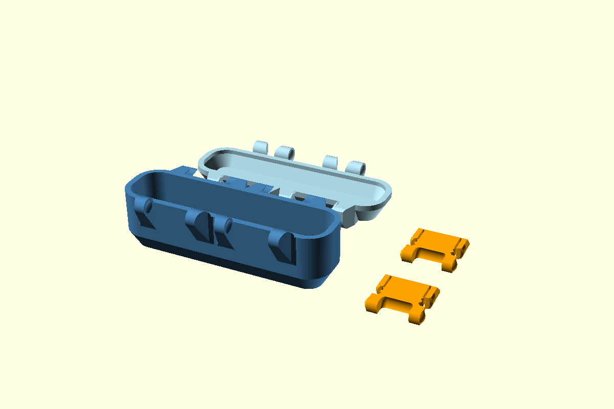

# Mẫu minimum — source cập nhật 14/10/2026

[Preset](parameters.json) dùng `length=107.9`, `width=30.1`, `body_height=30.2`, `lid_height=11.7` mm. Các thông số còn lại theo source chính. Latch được điều chỉnh span theo nắp 11,7 mm.

Nhập [body.stl](body.stl), [lid.stl](lid.stl) và **hai bản [latch.stl](latch.stl)** vào slicer ở tỷ lệ 100%, đơn vị mm. [layout.stl](layout.stl) chứa đủ bốn chi tiết. Kích thước bao thân khoảng 107,9 × 47,10 × 34,45 mm; nắp 107,9 × 47,34 × 16,20 mm; latch 28,00 × 28,54 × 6 mm.



[audit.json](audit.json) ghi hash source/STL, số solid và kích thước bao. Mỗi part riêng là một solid kín; layout gồm bốn solid. [Ma trận assembly hiện tại](../../docs/geometry/latch-parametric-fix.md) xác nhận cấu hình minimum đạt ngưỡng giao thể tích 0,01 mm³. Bước kiểm chứng tiếp theo là in mẫu để đo khe lắp và lực gài.

Chạy từ thư mục gốc repo để tái tạo layout:

```powershell
openscad --backend Manifold --hardwarnings --export-format binstl -p samples/minimum/parameters.json -P print-test-minimum -o samples/minimum/layout.stl snaplock-storage-box.scad
```

[Bộ nắp 15 mm](../minimum-lid15/README.md) dùng latch riêng cùng chiều cao nắp. [Chẩn đoán minimum trước sửa](../../docs/geometry/latch-minimum-fit.md) giữ kết quả của checkpoint lịch sử.
