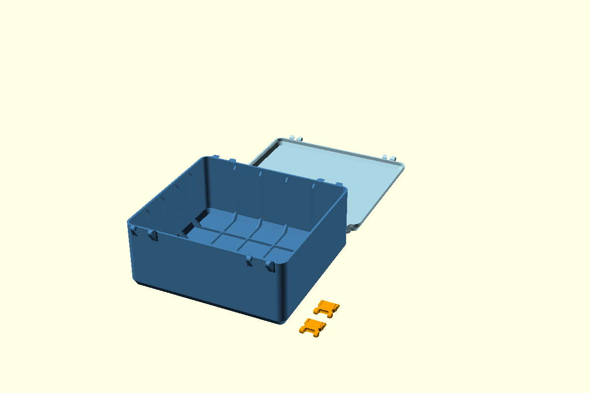

# Bản thử gân cao và chân nối lớn

STL hiện tại được xuất từ [SCAD cập nhật 14/10/2026](../../docs/geometry/latch-parametric-fix.md). Các báo cáo gân lịch sử bên dưới giữ hash của checkpoint tương ứng; [audit.json](audit.json) ghi hash các part hiện tại.

[Preset](parameters.json) dùng vỏ 240 × 220 × 100 mm và bật ba nhóm gân độc lập. File chính cũng dùng các kích thước gân mới khi bật công tắc trong Customizer. [Preset baseline](../reinforced-240x220/parameters.json) giữ thông số gân cũ để đối chiếu.

| Tham số | Baseline | Bản thử mới |
|---|---:|---:|
| `wall_rib_top_clearance` | 20 mm | 5 mm |
| `wall_rib_depth` | 3 mm | 5 mm |
| `wall_rib_foot` | 12 mm | 20 mm |
| `rib_thickness` | 2,4 mm | 2,4 mm |
| `floor_rib_height` | 4 mm | 4 mm |
| `rib_spacing` | 45 mm | 45 mm |

Gân thành lên tới khoảng Z=95 mm trên thân cao 100 mm; đầu gân giữ vát 45°. Chân tam giác có chiều dài và chiều cao danh nghĩa 20 mm, liên kết vào thành, đáy và lưới đáy khi bật cùng nhau. Công thức giới hạn chân và độ nhô theo lòng hộp, chiều cao khả dụng. Các công tắc `wall_ribs`, `wall_floor_ribs`, `floor_ribs` tiếp tục bật/tắt riêng từng loại.



## File in và kích thước

- [body.stl](body.stl) là thân với gân mới.
- [lid.stl](lid.stl) là nắp, giữ hình học baseline.
- [latch.stl](latch.stl) dùng số lượng hai khóa, giữ hình học baseline.

Slicer nhập STL theo mm, tỷ lệ 100%, và xếp từng chi tiết riêng. Thân có kích thước bao khoảng 240 × 237 × 104,25 mm; nắp khoảng 240 × 237,24 × 19,50 mm. Các chi tiết nằm trong khổ sử dụng 250 mm theo từng trục. Brim/skirt dùng phần khoảng trống còn lại theo cách xếp trong slicer.

Thể tích vật liệu thân trong mesh là khoảng 404,06 cm³, tăng khoảng 2,56% so với baseline có gân. Khối lượng thực tế phụ thuộc vật liệu và cấu hình đường in của slicer.

## Khoảng hở nắp và kiểm chứng

[Báo cáo](audit.json) ghi hash source, preset và STL. Nắp từ tư thế in được xoay 180° quanh X rồi dịch tới `(0,width,body_height+lid_height)`. Phép đặt này đưa tâm chốt nắp về trục ổ chốt thân ở Y=-4,75 mm, Z=`body_height`; tâm tai phía thân và phía nắp dùng cùng tọa độ X theo source hiện tại.

Với preset này, khoảng cách giữa Z thấp nhất của nắp đóng và Z cao nhất của phần gân bổ sung là khoảng 0,505 mm. Kiểm tra boolean tại góc mở 0°, 15°, 45°, 90° và 110° cho thể tích giao giữa gân và nắp bằng 0. Các góc quay lấy trục X đi qua Y=-4,75 mm, Z=100 mm.

Phạm vi bằng chứng gồm nắp đóng và năm tư thế mở lấy mẫu của checkpoint gân lịch sử. Bước tiếp theo là kiểm tra bổ sung và in mẫu để đánh giá liên tục toàn bộ hành trình, dung sai lắp thực tế và khả năng chịu tải.

[Bộ audit SCAD](../../docs/validation/scad-reinforcement.json) gồm 27 cấu hình: tám tổ hợp công tắc, kích thước gốc/lớn/nhỏ, khoảng chừa 20/5 mm, chân và độ nhô mới. Các thân là một solid kín, layout là bốn solid, hình bao ngoài được giữ. Phép so sánh xác nhận baseline vật liệu được giữ trong bản mới theo ngưỡng boolean đã ghi ở [hướng dẫn baseline](../reinforced-240x220/README.md).

## Tái tạo

Chạy tại thư mục gốc repo với OpenSCAD có backend Manifold:

```powershell
openscad --backend Manifold --hardwarnings --export-format binstl -p samples/reinforced-240x220-enhanced/parameters.json -P reinforced-240x220-enhanced -o samples/reinforced-240x220-enhanced/body.stl snaplock-storage-box.scad
python tools/audit-reinforcement.py
```

`wall_rib_top_clearance` nhận giá trị từ 5 mm tới dưới chiều cao trong của thân. Giá trị 5 mm là cấu hình thử theo envelope nắp hiện tại. Bước kiểm chứng vật lý tiếp theo là in mẫu và thử tải để đánh giá hiệu quả gia cường; checkpoint Fusion tiếp nối bước chốt SCAD.
