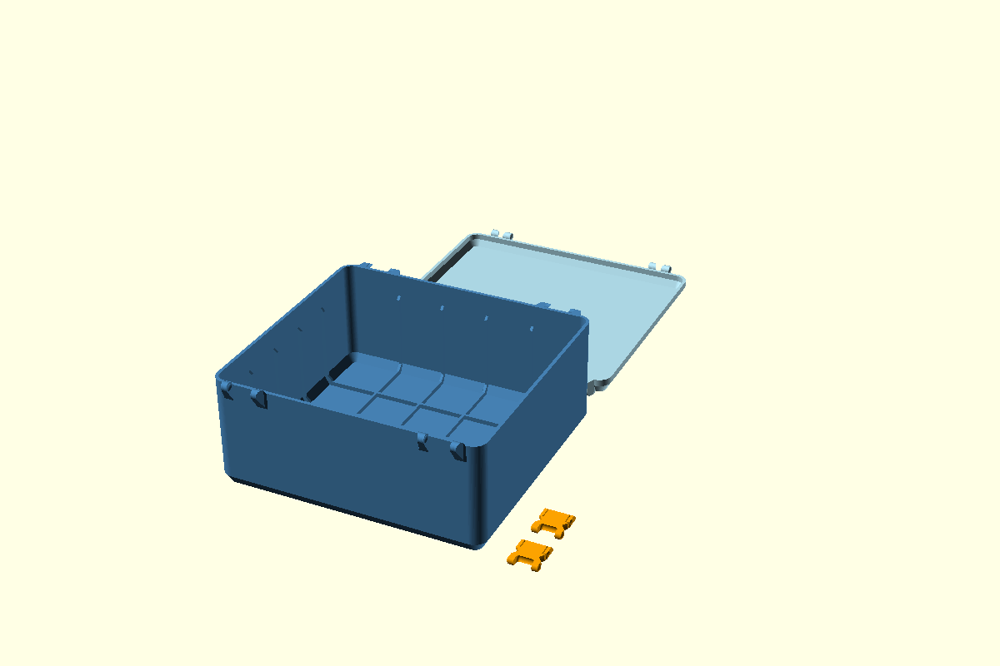

# Hộp có gân trong cho khổ in sử dụng 250 mm

STL hiện tại được xuất từ [SCAD cập nhật 14/10/2026](../../docs/geometry/latch-parametric-fix.md). Các báo cáo gân lịch sử bên dưới giữ hash của checkpoint tương ứng; [audit.json](audit.json) ghi hash các part hiện tại.

[Preset](parameters.json) đặt chiều dài 240 mm, chiều rộng 220 mm, chiều cao thân 100 mm và bật cả ba nhóm gân. Nắp cao 15 mm theo mặc định. Toàn bộ gân nằm trong hộp; mặt ngoài giữ hình dáng của vỏ gốc.

Đây là baseline với gân nhô 3 mm, chân nối 12 mm và khoảng chừa phía trên 20 mm được lưu rõ trong preset. [Bản thử mới](../reinforced-240x220-enhanced/README.md) dùng độ nhô 5 mm, chân nối 20 mm và khoảng chừa 5 mm. STL được xuất lại từ source hiện tại; kích thước gân baseline được giữ theo preset.

## File và cách dùng

- [body.stl](body.stl) là một thân hộp.
- [lid.stl](lid.stl) là một nắp hộp.
- [latch.stl](latch.stl) dùng số lượng hai khóa.

Slicer nhập STL ở tỷ lệ 100%, đơn vị mm. Các chi tiết được xếp trên bàn in riêng theo kích thước bao. Thân và nắp đều có chiều dài 240 mm; chiều rộng bao cả tai dưới 238 mm. Thân cao khoảng 104,25 mm tính cả tai. Bản kiểm chứng dùng khổ sử dụng 250 × 250 × 250 mm và lưu số đo chính xác trong [audit.json](audit.json). Brim và đường skirt dùng phần khoảng trống còn lại theo cách xếp thực tế trong slicer.



## Chỉnh trong OpenSCAD

Mở `snaplock-storage-box.scad`, chọn preset `reinforced-240x220` từ file JSON này và chọn `part="body"` để xem gân. Customizer có đúng ba công tắc bật/tắt độc lập:

- `wall_ribs`: gân đứng bám vào bốn thành, với đầu trên vát 45°.
- `wall_floor_ribs`: chân tam giác 45° nối thành xuống đáy.
- `floor_ribs`: lưới gân dọc và ngang trên mặt đáy.

File chính mặc định đặt cả ba công tắc thành `false`. Preset này đặt cả ba thành `true`. Mỗi nhóm hoạt động độc lập và có thể kết hợp với hai nhóm còn lại.

`rib_spacing` đặt khoảng cách tối đa giữa các trạm gân; vị trí trạm được chia đều và đối xứng theo kích thước hộp. `rib_thickness` đặt độ dày chung, `floor_rib_height` đặt chiều cao gân đáy. `wall_rib_depth` đặt độ nhô phần đứng, `wall_rib_foot` đặt chiều rộng chân tam giác 45°. Chân và độ nhô được giới hạn theo kích thước lòng hộp và chiều cao khả dụng. `wall_rib_top_clearance` điều khiển khoảng chừa đầu gân; preset baseline lưu giá trị 20 mm.

Kích thước gân là cấu hình hình học khởi đầu. Gân tạo gờ trong lòng và chiếm một phần dung tích sử dụng. Mẫu in và tải thử cung cấp bằng chứng chịu lực theo vật liệu, hướng in và cấu hình slicer thực tế.

## Tái tạo và kiểm chứng

Chạy ở thư mục gốc repo với OpenSCAD có backend Manifold:

```powershell
openscad --backend Manifold --hardwarnings --export-format binstl -p samples/reinforced-240x220/parameters.json -P reinforced-240x220 -o samples/reinforced-240x220/body.stl snaplock-storage-box.scad
python tools/audit-reinforcement.py
```

Trong Customizer, chọn `part="lid"` hoặc `part="latch"`, nhấn F6 và xuất STL để tạo từng chi tiết tương ứng. [Báo cáo bộ biến thể](../../docs/validation/scad-reinforcement.json) ghi 27 cấu hình, gồm đủ tám tổ hợp bật/tắt, solid kín, vật liệu bổ sung trong lòng, khoảng chừa chỉnh được và phép đặt nắp. So sánh boolean STL kiểm tra vật liệu bị mất dưới 0,1 mm³; tàn dư số học mỏng dùng ngưỡng thể tích từng mảnh 0,01 mm³, tỷ lệ thể tích/diện tích dưới 0,00001 mm và tổng dưới 0,05 mm³ khi đo bounds của phần thêm. Mẫu gốc và mẫu nhỏ giữ hình học cũ ở mặc định. Kích thước 350 × 200 × 100 mm trong báo cáo là ca thử hình học bổ sung; preset in này dùng kích thước 240 × 220 × 100 mm.

Checkpoint hiện tại là SCAD và mesh. Bản Fusion có gân tiếp nối mốc chốt SCAD.
